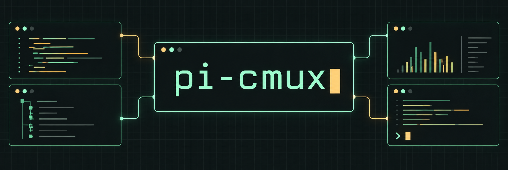

[](https://github.com/javiermolinar/pi-cmux/actions/workflows/ci.yml)
[](https://www.npmjs.com/package/pi-cmux)
[](https://www.npmjs.com/package/pi-cmux)
[](https://pi.dev)
[](https://opensource.org/licenses/MIT)

[Pi](https://pi.dev) tools for [cmux](https://www.cmux.dev): parallel chats, terminal commands, browser annotations and task handoffs.

[Install](#install) · [Commands](#commands) · [Configuration](#configuration) · [Usage guide](docs/usage.md)

## Capabilities

- Start independent chats or related reviewers; return to their origin with `/cmbk`.
- Run tools beside Pi, annotate browser pages and continue tasks in new worktrees.
- Show progress, tokens and optional notifications in the sidebar.


## Install

Requires **Pi 1.3.0+** and **Node.js 22.19.0+**, including the `pi` executable on your PATH.

```sh
pi install npm:pi-cmux
# Or install/update with:
npx pi-cmux
```

Run Pi inside cmux. For native notifications, session restore and prompt previews:

```sh
cmux hooks pi install
```

Package notifications default to off to avoid duplicate alerts. Zoxide is needed only for fuzzy directory matching.

## Commands

| Task | Command |
|---|---|
| New sidebar chat | `/cmn <prompt>` |
| Pi right/below | `/cmv [prompt]`, `/cmh [prompt]` |
| Tool right/below/tab | `/cmo <cmd>`, `/cmoh <cmd>`, `/cmt <cmd>` |
| Browser | `/cmb [--down] [--focus] <url>` |
| Browser annotations | Turn on **Annotate**; sending requires confirmation in Pi |
| Jump directory | `/cmz <path-or-query>`, `/cmzh <path-or-query>` |
| Return to origin | `/cmbk` or **Ctrl+Alt+B** |
| Continue task | `/cmcv [note]`, `/cmch [note]` |
| Continue in worktree | `/cmcv -c <branch> [--from <ref>] [note]` |
| Peer messages | `/cmmsg inbox`, `/cmmsg status`, `/cmmsg on`, `/cmmsg off` |

You can also ask Pi to open a tool, browser or another Pi session. Use `role: "review"` for a same-task reviewer without copied history; `continueSession: true` hands off context. Opt-in `returnResults: true` returns delegated findings as best-effort follow-ups, not permission for fixes. See [usage](docs/usage.md).

**Inspect cmux before retrying a failed open:** a surface may already exist. Creation is never retried automatically. `cmux_start_pi` checks for the exact child’s live Pi binding for up to 10 seconds and warns the parent if startup remains unconfirmed; a binding is not task readiness or completion.

## Experimental SSH

```text
Connect to javi in /srv/project
```

Pi and its credentials/session files stay local; core file/shell tools use the explicit remote target. Helpers default to that project; `/cmt --local k9s` or tool `target: "local"` stays on the Mac. Complete requests need no extra gate; missing details are asked one at a time. Alias saving is separate and requires an exact-preview confirmation.

Resume/child launches restore selection, not readiness. Remote-owned layouts, SSH handoffs/worktrees and new browser previews are unsupported. See [SSH setup, controls and limits](docs/ssh.md).

## Configuration

Set environment variables before starting Pi. Package settings belong in `~/.pi/agent/settings.json` or project `.pi/settings.json`; project settings override global settings.

| Variable | Default | Purpose |
|---|---|---|
| `PI_CMUX_PI_PATH_MODE` | `minimal` | Prepend Pi/Node directories to child PATH; `full` preserves caller PATH |
| `PI_CMUX_SSH` | `1` | `0` disables SSH integration without making saved remote intent local |
| `PI_CMUX_SSH_DISCOVERY` | `1` | `0` disables SSH suggestions |
| `PI_CMUX_SSH_ALIAS_SAVE` | `1` | `0` disables alias saving |
| `PI_CMUX_NOTIFY_LEVEL` | `disabled` | Opt in with `all`, `medium` or `low` |
| `PI_CMUX_SIDEBAR_MODE` | `detailed` | `minimal` shows status/tokens without package logs/progress |
| `PI_CMUX_RETURN_KEY` | `ctrl+alt+b` | Change shortcut or set `off`; `/cmbk` remains |
| `PI_CMUX_AUTOTITLE` | `0` | Enable model-generated topics; sends conversation excerpts and may incur charges |

[All settings and shortcuts](docs/usage.md#configuration) · [PATH behavior](docs/usage.md#pi-launch-path) · [Browser privacy](docs/usage.md#browser-annotations)

## Compatibility

Bundled Pi tabs/splits and helper terminals require verified local workspace metadata and exact creation UUIDs. Remote-owned or unverified placement is refused. New sidebar workspaces still use create + respawn; cmux's outer login shell may run profiles before the launch PATH takes effect. Standalone legacy Pi launch paths can do the same.

Workspace/browser behavior was tested on cmux **0.64.25**; orientation and ordinary-local-workspace SSH helper/child tabs on **0.65.2**. Other layouts and the latest launch-size changes lack native validation. See [compatibility details](docs/usage.md#compatibility) and [SSH evidence](docs/ssh-native-validation.md).
